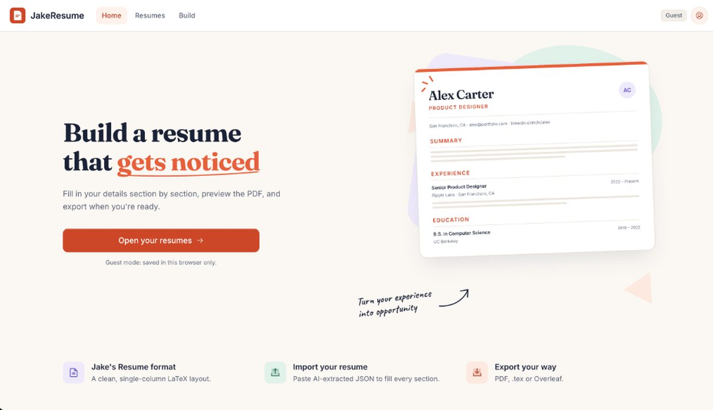

# JakeResume

A clean, distraction-free resume builder based on the classic Jake's Resume single-column LaTeX format.



## Features

- **Jake's Resume LaTeX layout**: Rendered via clean LaTeX formatting.
- **Guest mode saved in the browser**: Jump straight into editing; all changes are persisted locally in `localStorage` without requiring an account.
- **Google sign-in**: Optional account sync across devices using Google OAuth 2.0.
- **Import from AI-extracted JSON**: Import structured resume data directly into editor fields.
- **Undo/redo**: History tracking across edits in the resume builder.
- **Export your way**: Download rendered PDF, raw `.tex` source code, or open directly in Overleaf.

## Tech Stack

- **Frontend**: React 18, Vite, Vanilla CSS design tokens.
- **Backend**: Express, Node.js.
- **Database**: MongoDB (Mongoose) for optional user accounts and synchronized profiles.
- **Deployment**: Vercel (static frontend + serverless API functions).

## Local Development

### Prerequisites
- Node.js `>= 18.0.0` (specified in `package.json` engines)
- npm `>= 9.0.0`

### 1. Installation
Clone the repository and install all dependencies:

```bash
git clone https://github.com/Rohit-Pandey10/resume-builder.git
cd resume-builder
npm run install:all
```

### 2. Environment Variables
Copy the example environment templates:

```bash
# Server configuration (PORT, NODE_ENV, MONGODB_URI, JWT_SECRET, GOOGLE_CLIENT_ID, CLIENT_URL)
cp server/.env.example server/.env

# Client configuration (VITE_GOOGLE_CLIENT_ID, VITE_SITE_URL)
cp client/.env.example client/.env
```

Refer to `server/.env.example` and `client/.env.example` for variable definitions.

### 3. Running Locally
Run the client and server concurrently:

```bash
# Backend server (port 5001)
npm run dev:server

# Frontend client (port 5173)
npm run dev:client
```

Visit `http://localhost:5173` in your browser.

### 4. Testing & Verification

```bash
# Run server and client tests
npm test

# Full verification (lint, tests, builds)
npm run verify
```

## Deployment

JakeResume is deployed on Vercel with MongoDB Atlas. For detailed deployment instructions, Google Cloud OAuth setup, and operational runbooks, see [DEPLOYMENT.md](DEPLOYMENT.md).

## Privacy Note

When compiling resumes to PDF via live preview or PDF export, resume LaTeX code is transmitted to an upstream LaTeX compilation service (`latexonline.cc` by default). Do not include sensitive secrets or credentials in your resume content.
